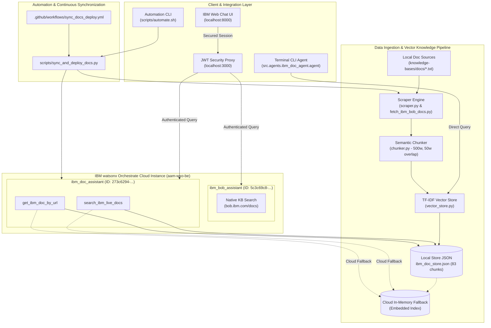
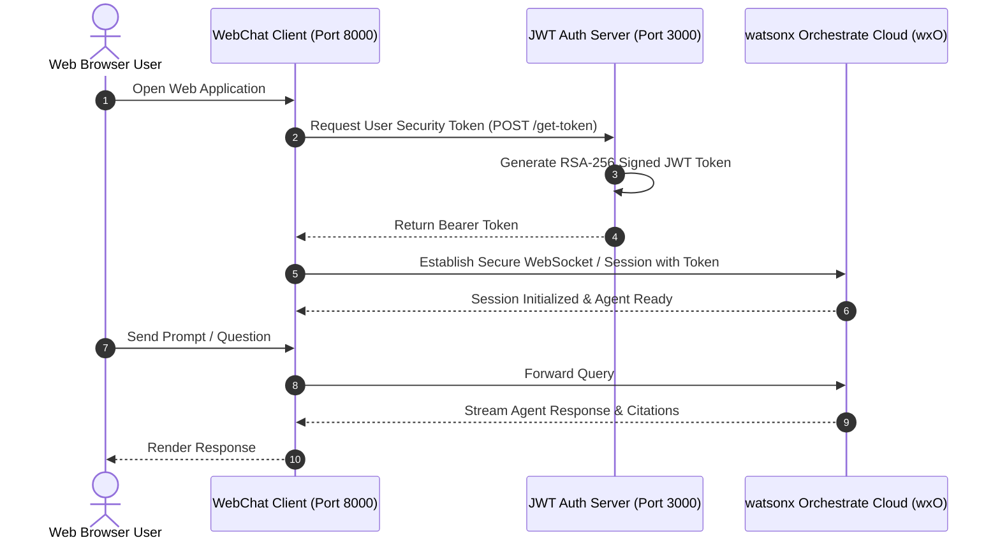

# watsonx Orchestrate Agent Architecture & Technical Blueprint

## 1. Executive Architecture Summary

This repository implements a modular, enterprise-grade dual-agent ecosystem on **IBM watsonx Orchestrate (wxO)** designed to provide comprehensive, grounded, and verified support for **IBM Bob** and associated developer tooling across both enterprise cloud environments and local development workflows.



---

## 2. Component Taxonomy & Deep-Dive

### 2.1 Agent 1: `ibm_bob_assistant` (Native Orchestrate RAG)
- **Role**: High-level conversational assistant grounded directly in native watsonx Orchestrate knowledge base collections.
- **Agent Configuration**: Defined in [`agents/ibm_bob_assistant.agent.yaml`](../agents/ibm_bob_assistant.agent.yaml).
- **Core Strengths**: Fast out-of-the-box responses using IBM foundation models and managed cloud vector search indices.

### 2.2 Agent 2: `ibm_doc_assistant` (Custom Python Agent with Hybrid Live RAG)
- **Role**: Autonomous documentation specialist equipped with custom tools for semantic vector retrieval, full text fetching by URL, and keyword matching.
- **Agent Configuration**: Defined in [`agents/ibm_doc_assistant.agent.yaml`](../agents/ibm_doc_assistant.agent.yaml) and [`src/agents/ibm_doc_agent/agent.py`](../src/agents/ibm_doc_agent/agent.py).
- **Tool Catalog**:
  1. [`search_ibm_live_docs(query, max_results)`](../src/agents/ibm_doc_agent/tools.py): Semantic vector cosine similarity lookup across indexed documentation chunks with relevance scores.
  2. [`get_ibm_doc_by_url(url)`](../src/agents/ibm_doc_agent/tools.py): URL-based exact content extractor returning clean section text and metadata.

---

## 3. Data Ingestion & Vector Architecture

### 3.1 Document Scraping & SPA Strategy
Modern web documentation platforms (including `https://bob.ibm.com/docs`) render content via client-side JavaScript Single Page Applications (SPAs). Standard synchronous HTTP GET requests yield empty root containers (`<div id="root"></div>`).

The ingestion pipeline solves this through a multi-tier strategy:
1. **API / Raw Fetching**: Directly querying internal documentation endpoints or pre-rendered markdown/text representations via [`scripts/fetch_ibm_bob_docs.py`](../scripts/fetch_ibm_bob_docs.py).
2. **Local Directory Ingestion**: Ingesting canonical source documents directly from [`knowledge-bases/docs/`](../knowledge-bases/docs/).
3. **HTML Stripping & Normalization**: Stripping navigation bars, scripts, styles, and normalizing whitespace in [`src/agents/ibm_doc_agent/scraper.py`](../src/agents/ibm_doc_agent/scraper.py).

### 3.2 Semantic Chunking Engine
Located in [`src/agents/ibm_doc_agent/chunker.py`](../src/agents/ibm_doc_agent/chunker.py):
- **Chunk Size**: Configured by default to 500 words.
- **Overlap**: 50 words sliding window to maintain syntactic and contextual continuity across chunk boundaries.
- **Boundary Preservation**: Splits respecting sentence boundaries (`.`, `!`, `?`) and paragraph breaks (`\n\n`) to prevent abrupt context loss.
- **Deterministic ID Generation**: SHA256-based chunk IDs derived from source URL and sequence index (`doc_url#chunk_idx`).

### 3.3 Vector Indexing & TF-IDF Similarity Engine
Located in [`src/agents/ibm_doc_agent/vector_store.py`](../src/agents/ibm_doc_agent/vector_store.py):
- **Vector Space**: Sparse TF-IDF representations combined with sub-linear term frequency scaling and inverse document frequency damping.
- **Similarity Metric**: Cosine similarity:
  $$\text{sim}(q, d) = \frac{\vec{q} \cdot \vec{d}}{\|\vec{q}\|_2 \|\vec{d}\|_2}$$
- **Persistence**: Serialized as JSON in [`knowledge-bases/ibm_doc_store.json`](../knowledge-bases/ibm_doc_store.json).

---

## 4. Cloud Microservice Tool Isolation & Resilience

### The Cloud Isolation Challenge
In watsonx Orchestrate cloud runtime (`api.eu-de.watson-orchestrate.cloud.ibm.com`), `@tool` functions run in isolated, stateless microservice execution sandboxes. They do not share persistent local filesystem volumes with the deployment environment. Consequently, attempting to read `knowledge-bases/ibm_doc_store.json` on cloud execution triggers file not found exceptions unless bundled or fallback-enabled.

### The Dual-Store Resolution
[`src/agents/ibm_doc_agent/tools.py`](../src/agents/ibm_doc_agent/tools.py) implements a resilient hybrid approach:
1. **Primary Layer**: Attempts to read dynamic local vector store JSON if available in current execution path.
2. **Fallback Layer**: Falls back seamlessly to an embedded in-memory corpus containing full coverage of the 11 canonical IBM Bob documentation guides (Getting Started, Agents, Modes, MCP Configuration, Prompting, Shortcuts, Troubleshooting, CLI Reference, Models, and Skills).

---

## 5. Security & Authentication Architecture



- **Algorithm**: RSA-256 asymmetric signing (`RS256`).
- **Key Storage**: Private key stored locally in [`keys/private.pem`](../keys/private.pem), public key uploaded to Orchestrate configuration.
- **Port Allocation**: Port `3000` for JWT server, Port `8000` for WebChat static hosting (guaranteeing compliance with macOS Port 5000 AirDrop restrictions).

---

## 6. Directory Structure & Asset Map

```
wxO-IBM/
├── .github/
│   └── workflows/
│       └── sync_docs_deploy.yml         # Daily automated sync & deployment CI/CD
├── Docs/
│   ├── ARCHITECTURE.md                  # System architecture & data flow (this document)
│   ├── Documentation.md                 # Unified master project documentation (Markdown)
│   ├── Documentation.html               # Unified master project documentation (Interactive HTML)
│   ├── KNOWLEDGE_BASE_REFRESH.md        # Operations & refresh manual
│   ├── New_Agent_Documentation.md       # Specialized IBM Doc Agent guide
│   ├── New_Agent_Documentation.html     # Specialized IBM Doc Agent guide (HTML)
│   ├── Quickstart.md                    # Fast path user guide
│   └── WATSONX_ORCHESTRATE_DEPLOYMENT.md# Cloud deployment & troubleshooting reference
├── agents/
│   ├── ibm_bob_assistant.agent.yaml     # Native RAG agent definition
│   └── ibm_doc_assistant.agent.yaml     # Custom Python tool-calling agent definition
├── keys/
│   ├── private.pem                      # RSA private key for JWT signing
│   └── public.pem                       # RSA public key for wxO auth
├── knowledge-bases/
│   ├── docs/                            # Canonical source documentation text files (11 files)
│   ├── ibm_doc_store.json               # Indexed vector database (83 chunks)
│   └── ibm_doc_store.kb.yaml            # Declarative KB schema definition
├── logs/
│   ├── automate.log                     # Central automation execution log
│   ├── jwt_server.log                   # JWT server runtime log
│   └── webchat.log                      # HTTP static server runtime log
├── output/                              # Timestamped execution outputs & sync reports
├── scripts/
│   ├── automate.sh                      # Master CLI management interface
│   ├── deploy_orchestrate_agent.py      # Cloud agent & tool deployment script
│   ├── fetch_ibm_bob_docs.py            # Direct Bob API documentation fetcher
│   ├── ingest_docs.py                   # Document scraper & chunker CLI
│   ├── jwt_server.py                    # Local RSA JWT signing server
│   ├── serve.sh                         # Webchat server runner
│   ├── start.sh                         # Background multi-service daemon starter
│   ├── stop.sh                          # Graceful service shutdown script
│   └── sync_and_deploy_docs.py          # Full sync & re-deploy orchestration script
├── src/
│   └── agents/
│       └── ibm_doc_agent/
│           ├── __init__.py              # Package initializer & exports
│           ├── agent.py                 # Interactive terminal agent runtime
│           ├── chunker.py               # Semantic document chunker
│           ├── models.py                # Pydantic data models
│           ├── openapi_spec.json        # OpenAPI 3.0 specification for wxO tools
│           ├── scraper.py               # Document fetcher & normalizer
│           ├── tools.py                 # wxO @tool implementations
│           └── vector_store.py          # TF-IDF vector similarity engine
├── tests/
│   ├── test_ibm_doc_agent.py            # Unit tests for chunker, scraper, store, tools
│   └── test_sync_and_deploy_docs.py     # Unit tests for synchronization pipeline
├── requirements.txt                     # Python dependencies
└── README.md                            # Repository root landing page
```
