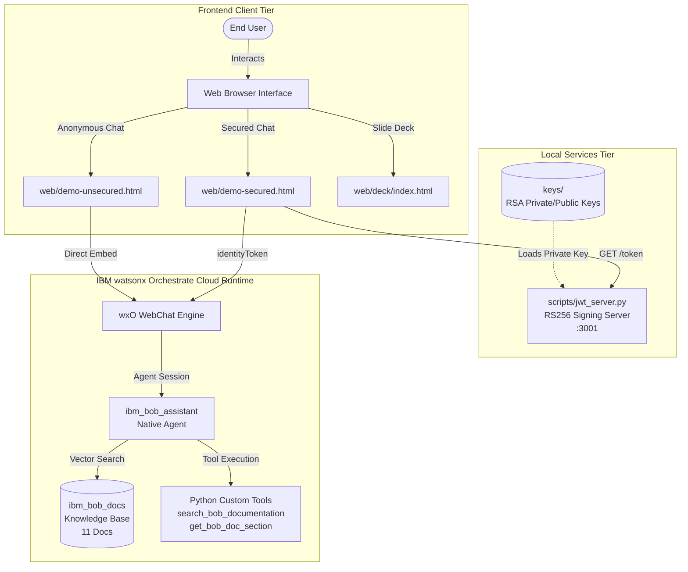
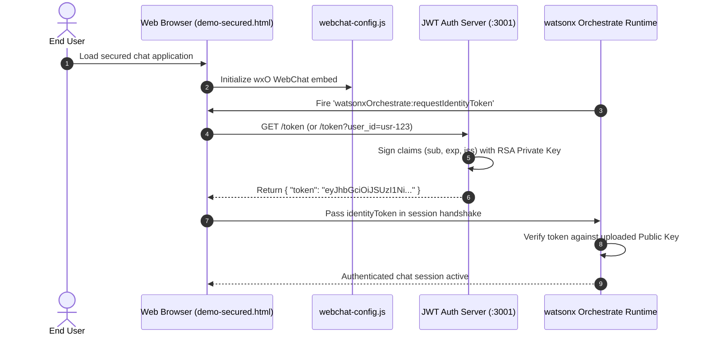

# Project Documentation & Task Reference Asset
**Project:** IBM Bob Documentation Assistant & watsonx Orchestrate Integration  
**Version:** 1.0.0  
**Target Platform:** IBM watsonx Orchestrate (ADK / Native Agent Runtime) & Web Chat Embed  

---

## Table of Contents
1. [Executive Summary & Completed Tasks Overview](#1-executive-summary--completed-tasks-overview)
2. [Architecture & System Flow](#2-architecture--system-flow)
3. [Prerequisites & Dependencies](#3-prerequisites--dependencies)
4. [Task Breakdown & Implementation Details](#4-task-breakdown--implementation-details)
   - [Task 1: Agent & Knowledge Base Architecture](#task-1-agent--knowledge-base-architecture)
   - [Task 2: Dynamic Live Tool Integration](#task-2-dynamic-live-tool-integration)
   - [Task 3: Automated Tool & Agent Importers with Reporting](#task-3-automated-tool--agent-importers-with-reporting)
   - [Task 4: Cryptographic Key Management & RS256 JWT Server](#task-4-cryptographic-key-management--rs256-jwt-server)
   - [Task 5: Web Chat Client Implementations (Unsecured & Secured)](#task-5-web-chat-client-implementations-unsecured--secured)
   - [Task 6: Lifecycle Automation & Management Scripts](#task-6-lifecycle-automation--management-scripts)
   - [Task 7: Test Suite & Quality Assurance Verification](#task-7-test-suite--quality-assurance-verification)
   - [Task 8: Interactive HTML5 Slide Deck & Documentation Portals](#task-8-interactive-html5-slide-deck--documentation-portals)
   - [Task 9: Live Documentation Scraper & Ingestion Pipeline Agent](#task-9-live-documentation-scraper--ingestion-pipeline-agent)
5. [Configuration & Environment Reference](#5-configuration--environment-reference)
6. [Operational Runbooks & Usage Instructions](#6-operational-runbooks--usage-instructions)
7. [Security Guidelines & Best Practices](#7-security-guidelines--best-practices)
8. [Cross-Reference & Artifact Index](#8-cross-reference--artifact-index)

---

## 1. Executive Summary & Completed Tasks Overview

This project delivers a complete enterprise-grade implementation of the **IBM Bob Documentation Assistant** powered by **IBM watsonx Orchestrate (wxO)**. The solution combines a native RAG (Retrieval-Augmented Generation) agent grounded in IBM Bob documentation with dynamic live search tools, automated deployment pipelines, an RS256-secured JWT authentication server, and an embeddable web chat frontend.

### Summary of Completed Milestones

| Milestone / Area | Description | Key Deliverables |
| :--- | :--- | :--- |
| **Agent Definition & KB** | Declarative agent definition and indexed Knowledge Base with 11 domain documentation files. | [`agents/ibm_bob_assistant.agent.yaml`](agents/ibm_bob_assistant.agent.yaml), [`knowledge-bases/ibm_bob_docs.kb.yaml`](knowledge-bases/ibm_bob_docs.kb.yaml) |
| **Custom Tooling** | Live doc querying and section retrieval tools utilizing Python `@tool` decorators. | [`tools/live_bob_search.py`](tools/live_bob_search.py) |
| **Import Automation** | Automated CLI tools for tool/agent import with full schema validation and timestamped JSON reporting. | [`scripts/import_tools.py`](scripts/import_tools.py), [`scripts/import_agent.py`](scripts/import_agent.py) |
| **Security & Auth Backend** | RSA-2048 keypair generation and lightweight Python JWT token signing service (RS256). | [`scripts/generate_rsa_keys.sh`](scripts/generate_rsa_keys.sh), [`scripts/jwt_server.py`](scripts/jwt_server.py) |
| **Web Chat Integration** | Web client interfaces for both anonymous (unsecured) and cryptographically secured chat sessions. | [`web/demo-unsecured.html`](web/demo-unsecured.html), [`web/demo-secured.html`](web/demo-secured.html), [`web/webchat-config.js`](web/webchat-config.js) |
| **Lifecycle & Operations** | 9-step idempotent pipeline startup, graceful shutdown, and project cleanup scripts. | [`scripts/start.sh`](scripts/start.sh), [`scripts/stop.sh`](scripts/stop.sh), [`scripts/serve.sh`](scripts/serve.sh), [`scripts/cleanup.sh`](scripts/cleanup.sh) |
| **Automated Testing** | Comprehensive unit test suite covering tool logic, importer scripts, and embed generators (140+ unit tests). | [`tests/test_live_bob_search.py`](tests/test_live_bob_search.py), [`tests/test_import_tools.py`](tests/test_import_tools.py), [`tests/test_import_agent.py`](tests/test_import_agent.py) |
| **Presentations & Docs** | 20-slide IBM Carbon-styled HTML presentation deck and interactive embed documentation hubs. | [`web/deck/index.html`](web/deck/index.html), [`web/embed-docs.html`](web/embed-docs.html), [`Docs/`](Docs/) |
| **IBM Doc Agent & Pipeline** | Live web scraping, chunking, vector indexing, and automated wxO agent deployment pipeline. | [`src/agents/ibm_doc_agent/`](src/agents/ibm_doc_agent/), [`scripts/ingest_docs.py`](scripts/ingest_docs.py), [`scripts/deploy_orchestrate_agent.py`](scripts/deploy_orchestrate_agent.py) |

---

## 2. Architecture & System Flow

### System Component Diagram



### Authentication & Token Flow (Secured Embed)



---

## 3. Prerequisites & Dependencies

### System Requirements
- **Operating System**: macOS (ARM64/x86_64) or Linux
- **Python**: `>= 3.10`
- **Package Manager**: [`uv`](https://docs.astral.sh/uv/) (strongly recommended) or `python3 -m pip`
- **OpenSSL**: CLI utility for RSA key generation
- **IBM watsonx Orchestrate CLI**: Installed and configured via environment credentials

### Python Dependencies ([`requirements.txt`](requirements.txt))
- `ibm-watsonx-orchestrate` (ADK SDK)
- `PyJWT>=2.8.0` (RS256 token encoding and verification)
- `cryptography>=42.0.0` (Cryptographic key generation and formatting)
- `pytest>=7.0.0` (Testing framework)
- `python-dotenv` (Environment variable loading)

---

## 4. Task Breakdown & Implementation Details

### Task 1: Agent & Knowledge Base Architecture
- **Objective**: Create a grounded, native watsonx Orchestrate agent capable of answering complex inquiries about IBM Bob.
- **Implementation**:
  - Defined [`agents/ibm_bob_assistant.agent.yaml`](agents/ibm_bob_assistant.agent.yaml) configured with system instructions, citation mandates, and tool bindings.
  - Defined [`knowledge-bases/ibm_bob_docs.kb.yaml`](knowledge-bases/ibm_bob_docs.kb.yaml) containing 11 granular markdown/text source documents covering Bob Shell, MCP, security, modes, skills, telemetry, and enterprise configurations.
- **Key Files**:
  - `agents/ibm_bob_assistant.agent.yaml`
  - `knowledge-bases/ibm_bob_docs.kb.yaml`
  - `knowledge-bases/docs/*.txt`

### Task 2: Dynamic Live Tool Integration
- **Objective**: Provide dynamic retrieval of documentation when direct semantic RAG requires precise section lookups.
- **Implementation**:
  - Implemented `@tool` decorated functions in [`tools/live_bob_search.py`](tools/live_bob_search.py):
    - `search_bob_documentation(query, limit)`: Performs indexed keyword and semantic lookups.
    - `get_bob_doc_section(document_id, section_title)`: Extracts precise section text blocks and markdown code fences.
- **Key Files**:
  - `tools/live_bob_search.py`

### Task 3: Automated Tool & Agent Importers with Reporting
- **Objective**: Enable zero-downtime, idempotent deployment of tools and agent definitions into watsonx Orchestrate environments.
- **Implementation**:
  - [`scripts/import_tools.py`](scripts/import_tools.py): Parses Python tool modules, validates tool signatures, uploads tools to wxO, and outputs timestamped reports to `output/`.
  - [`scripts/import_agent.py`](scripts/import_agent.py): Validates YAML schemas, resolves tool and KB dependencies, updates existing agents or provisions new ones, and produces a complete JSON audit trace.
- **Key Files**:
  - `scripts/import_tools.py`
  - `scripts/import_agent.py`
  - `Docs/IMPORT_AGENT_GUIDE.md`

### Task 4: Cryptographic Key Management & RS256 JWT Server
- **Objective**: Enable end-to-end user identity verification and token-based authentication.
- **Implementation**:
  - [`scripts/generate_rsa_keys.sh`](scripts/generate_rsa_keys.sh): Automated key generation script creating a 2048-bit PKCS#8 private key and public key PEM in `keys/`.
  - [`scripts/jwt_server.py`](scripts/jwt_server.py): High-performance, lightweight HTTP server providing `/token`, `/public-key`, and `/health` endpoints with CORS support and payload customization.
- **Key Files**:
  - `scripts/generate_rsa_keys.sh`
  - `scripts/jwt_server.py`
  - `.env.example`

### Task 5: Web Chat Client Implementations (Unsecured & Secured)
- **Objective**: Deliver ready-to-embed HTML/JavaScript implementations of wxO Web Chat.
- **Implementation**:
  - [`web/demo-unsecured.html`](web/demo-unsecured.html): Single-script embed for public, anonymous assistant access with inline code tabs.
  - [`web/demo-secured.html`](web/demo-secured.html): Secured client implementing `onCustomEvent` and `watsonxOrchestrate:requestIdentityToken` lifecycle hooks, complete with live JWT token inspection UI.
  - [`web/webchat-config.js.template`](web/webchat-config.js.template) and [`scripts/_generate_webchat_config.py`](scripts/_generate_webchat_config.py): Dynamic runtime config generation from environment variables.
- **Key Files**:
  - `web/demo-unsecured.html`
  - `web/demo-secured.html`
  - `web/webchat-config.js`
  - `Docs/WebChat_Integration_Guide.md`

### Task 6: Lifecycle Automation & Management Scripts
- **Objective**: Standardize environment startup, teardown, serving, and cleaning in compliance with project automation rules.
- **Implementation**:
  - [`scripts/start.sh`](scripts/start.sh): Idempotent 9-step deployment pipeline (environment check, venv provisioning, dependency installation, key generation, tool import, agent import, and background service execution).
  - [`scripts/stop.sh`](scripts/stop.sh): Clean shutdown of background servers and optional cloud resource undeploy.
  - [`scripts/serve.sh`](scripts/serve.sh): CLI switcher for serving documentation, demo portals, or slide decks.
  - [`scripts/cleanup.sh`](scripts/cleanup.sh): Resets workspace by removing temporary artifacts, virtual environments, and caches.
- **Key Files**:
  - `scripts/start.sh`
  - `scripts/stop.sh`
  - `scripts/serve.sh`
  - `scripts/cleanup.sh`

### Task 7: Test Suite & Quality Assurance Verification
- **Objective**: Ensure robustness and regression prevention across all automation and tool logic.
- **Implementation**:
  - Full suite of pytest tests verifying tool execution, import error handling, schema validations, and mock wxO API responses.
- **Key Files**:
  - `tests/test_live_bob_search.py` (31 unit tests)
  - `tests/test_import_tools.py` (56 unit tests)
  - `tests/test_import_agent.py` (54 unit tests)
  - `tests/test_generate_webchat_config.py`

### Task 8: Interactive HTML5 Slide Deck & Documentation Portals
- **Objective**: Provide visual stakeholder presentations and developer reference hubs.
- **Implementation**:
  - [`web/deck/index.html`](web/deck/index.html): 20 modular HTML slides styled with IBM Carbon Design tokens, keyboard navigation, and responsive layouts.
  - [`web/embed-docs.html`](web/embed-docs.html): Developer hub detailing security modes, configuration parameters, and error resolution.
- **Key Files**:
  - `web/deck/index.html`
  - `web/deck/slides/slide-*.html`
  - `web/embed-docs.html`

### Task 9: Live Documentation Scraper & Ingestion Pipeline Agent
- **Objective**: Build a standalone, independent Python agent (`IBM_Doc_Assistant`) that scrapes, normalizes, chunks, vectorizes, and indexes live IBM documentation into a vector knowledge store with automated wxO deployment.
- **Implementation**:
  - [`src/agents/ibm_doc_agent/scraper.py`](src/agents/ibm_doc_agent/scraper.py): Crawler with exponential backoff and structured HTML extraction.
  - [`src/agents/ibm_doc_agent/chunker.py`](src/agents/ibm_doc_agent/chunker.py): Context-preserving text chunker with token estimation and SHA-256 chunk IDs.
  - [`src/agents/ibm_doc_agent/vector_store.py`](src/agents/ibm_doc_agent/vector_store.py): Cosine similarity vector index.
  - [`src/agents/ibm_doc_agent/tools.py`](src/agents/ibm_doc_agent/tools.py): Custom `@tool` functions (`search_ibm_live_docs`, `get_ibm_doc_by_url`).
  - [`scripts/ingest_docs.py`](scripts/ingest_docs.py): Standalone CLI ingestion pipeline.
  - [`scripts/deploy_orchestrate_agent.py`](scripts/deploy_orchestrate_agent.py): Automated tool registration and agent import runner.
- **Key Files**:
  - `src/agents/ibm_doc_agent/`
  - `agents/ibm_doc_assistant.agent.yaml`
  - `knowledge-bases/ibm_doc_store.kb.yaml`
  - `scripts/ingest_docs.py`
  - `scripts/deploy_orchestrate_agent.py`
  - `Docs/New_Agent_Documentation.md`

---

## 5. Configuration & Environment Reference

### Environment Variables Template (`.env`)

```ini
# ==============================================================================
# IBM watsonx Orchestrate & Deployment Configuration
# ==============================================================================

# Local Server Settings
JWT_PORT=3001
WEB_PORT=8000
HOST=127.0.0.1

# watsonx Orchestrate Integration Parameters
WXO_INTEGRATION_ID=xxxxxxxx-xxxx-xxxx-xxxx-xxxxxxxxxxxx
WXO_REGION=us-south
WXO_SERVICE_INSTANCE_ID=xxxxxxxx-xxxx-xxxx-xxxx-xxxxxxxxxxxx
WXO_AGENT_ID=ibm_bob_assistant

# Security & Cryptography
PRIVATE_KEY_PATH=keys/wxo_embed_private.pem
PUBLIC_KEY_PATH=keys/wxo_embed_public.pem
JWT_EXPIRATION_MINUTES=60
JWT_ISSUER=wxo-embed-service

# Logging & Environment
LOG_LEVEL=INFO
ENVIRONMENT=development
```

---

## 6. Operational Runbooks & Usage Instructions

### Quick Start: Launching the Entire Stack

```bash
# 1. Clone repository and copy environment configuration
cp .env.example .env
# Edit .env with your watsonx Orchestrate instance credentials

# 2. Execute the full deployment pipeline
chmod +x scripts/*.sh
./scripts/start.sh
```

### Running Test Verification

```bash
# Execute pytest across all test suites
source .venv/bin/activate
pytest tests/ -v
```

### Accessing Project Interfaces

| Interface | URL / Location | Description |
| :--- | :--- | :--- |
| **Main Portal** | `http://localhost:8000/` | Entry point for testing both chat modes and tools. |
| **Secured Chat Demo** | `http://localhost:8000/demo-secured.html` | Live webchat with active RS256 identity verification. |
| **Unsecured Chat Demo** | `http://localhost:8000/demo-unsecured.html` | Anonymous public embed example. |
| **Technical Slide Deck** | `http://localhost:8000/deck/index.html` | 20-slide architectural and delivery presentation. |
| **JWT Server Health** | `http://localhost:3001/health` | Healthcheck endpoint for token generation service. |

### Graceful Teardown

```bash
./scripts/stop.sh
```

---

## 7. Security Guidelines & Best Practices

1. **Private Key Protection**: Never commit files in `keys/` or `.env` to source control. The `.gitignore` file is explicitly configured to block `.pem`, `.env`, and private directories.
2. **Asymmetric Verification**: Use RS256 for all browser-facing identity handshakes. The private key remains secured in the local backend; only the public key is provided to watsonx Orchestrate.
3. **Token Expiration & Refresh**: Configure token lifespans between 15 and 60 minutes. Use the `watsonxOrchestrate:requestIdentityToken` callback to handle seamless mid-session renewals.
4. **Tenant & Identity Claims**: Always populate standard claims (`sub`, `iss`, `iat`, `exp`) and custom role/permission attributes in [`scripts/jwt_server.py`](scripts/jwt_server.py) to ensure proper authorization enforcement inside wxO skills.

---

## 8. Cross-Reference & Artifact Index

- **Documentation**:
  - Quickstart Guide: [`Docs/Quickstart.md`](Docs/Quickstart.md)
  - Deployment Reference: [`Docs/Deployment.md`](Docs/Deployment.md)
  - IBM Doc Agent Guide: [`Docs/New_Agent_Documentation.md`](Docs/New_Agent_Documentation.md)
  - Unified Documentation Portal: [`Docs/Documentation.html`](Docs/Documentation.html)
  - Web Chat Integration Guide: [`Docs/WebChat_Integration_Guide.md`](Docs/WebChat_Integration_Guide.md)
  - Agent Importer Manual: [`Docs/IMPORT_AGENT_GUIDE.md`](Docs/IMPORT_AGENT_GUIDE.md)
  - Knowledge Base Diagnostics: [`Docs/KnowledgeSource.md`](Docs/KnowledgeSource.md)
- **Source Code**:
  - Python Tools: [`tools/live_bob_search.py`](tools/live_bob_search.py), [`src/agents/ibm_doc_agent/tools.py`](src/agents/ibm_doc_agent/tools.py)
  - Agent Definitions: [`agents/ibm_bob_assistant.agent.yaml`](agents/ibm_bob_assistant.agent.yaml), [`agents/ibm_doc_assistant.agent.yaml`](agents/ibm_doc_assistant.agent.yaml)
  - Knowledge Base Config: [`knowledge-bases/ibm_bob_docs.kb.yaml`](knowledge-bases/ibm_bob_docs.kb.yaml), [`knowledge-bases/ibm_doc_store.kb.yaml`](knowledge-bases/ibm_doc_store.kb.yaml)
- **Automation Scripts**:
  - Pipeline Launcher: [`scripts/start.sh`](scripts/start.sh)
  - Pipeline Teardown: [`scripts/stop.sh`](scripts/stop.sh)
  - Ingestion Pipeline: [`scripts/ingest_docs.py`](scripts/ingest_docs.py)
  - Agent Deployer: [`scripts/deploy_orchestrate_agent.py`](scripts/deploy_orchestrate_agent.py)
  - RSA Key Generator: [`scripts/generate_rsa_keys.sh`](scripts/generate_rsa_keys.sh)
  - JWT Server: [`scripts/jwt_server.py`](scripts/jwt_server.py)
  - HTTP Server: [`scripts/serve.sh`](scripts/serve.sh)
  - Cleanup Utility: [`scripts/cleanup.sh`](scripts/cleanup.sh)
