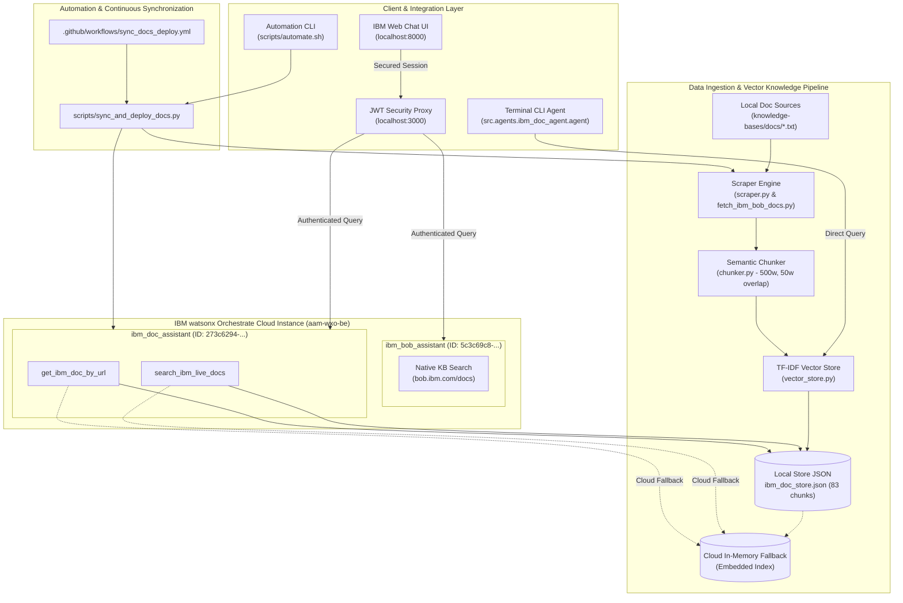

# Project Completion & Master Technical Documentation

---

## 1. Executive Summary & Project Scope

This project delivers a production-ready, dual-agent architecture on **IBM watsonx Orchestrate (wxO)** deployed in instance **`aam-wxo-be`** (`https://api.eu-de.watson-orchestrate.cloud.ibm.com/instances/75c2cabb-2b02-4d65-8127-a9cc65d1ee46`).

The system bridges enterprise knowledge management with conversational AI, offering both a native watsonx Orchestrate agent (`ibm_bob_assistant`) and an autonomous, Python-powered live documentation agent (`ibm_doc_assistant`) backed by a custom scraping, semantic chunking, and vector indexing engine.

---

## 2. Table of Contents

- [1. Executive Summary & Project Scope](#1-executive-summary--project-scope)
- [2. Table of Contents](#2-table-of-contents)
- [3. Summary of Completed Tasks](#3-summary-of-completed-tasks)
- [4. Architectural Blueprint & Data Flow](#4-architectural-blueprint--data-flow)
- [5. Component Descriptions & Implementation Details](#5-component-descriptions--implementation-details)
  - [5.1 The `ibm_doc_agent` Package](#51-the-ibm_doc_agent-package)
  - [5.2 Semantic Chunking & Vector Engine](#52-semantic-chunking--vector-engine)
  - [5.3 watsonx Orchestrate Agent & Tool Deployment](#53-watsonx-orchestrate-agent--tool-deployment)
  - [5.4 Enterprise Security & JWT Token Exchange](#54-enterprise-security--jwt-token-exchange)
  - [5.5 Continuous Synchronization & CI/CD Pipeline](#55-continuous-synchronization--cicd-pipeline)
- [6. Prerequisites & Environment Setup](#6-prerequisites--environment-setup)
- [7. Comprehensive Usage Instructions](#7-comprehensive-usage-instructions)
  - [7.1 Using the Master Automation Script (`automate.sh`)](#71-using-the-master-automation-script-automatesh)
  - [7.2 Running the Interactive Terminal CLI Agent](#72-running-the-interactive-terminal-cli-agent)
  - [7.3 Running the Local Web Chat Application](#73-running-the-local-web-chat-application)
- [8. Configuration Details & Environment Variables](#8-configuration-details--environment-variables)
- [9. Testing, Validation & Verification Results](#9-testing-validation--verification-results)
- [10. Technical Assets & Cross-References](#10-technical-assets--cross-references)

---

## 3. Summary of Completed Tasks

| Task # | Task Title | Primary Deliverables | Status |
|:---|:---|:---|:---:|
| **Task 1** | **Repository Environment & Dependency Setup** | [`requirements.txt`](../requirements.txt), [`workspace_config.yaml`](../workspace_config.yaml), Virtual Environment | **Completed** |
| **Task 2** | **Native wxO Agent Setup (`ibm_bob_assistant`)** | [`agents/ibm_bob_assistant.agent.yaml`](../agents/ibm_bob_assistant.agent.yaml), [`knowledge-bases/docs/`](../knowledge-bases/docs/) | **Completed** |
| **Task 3** | **Live Doc Scraper & Semantic Ingestion Pipeline** | [`src/agents/ibm_doc_agent/scraper.py`](../src/agents/ibm_doc_agent/scraper.py), [`src/agents/ibm_doc_agent/chunker.py`](../src/agents/ibm_doc_agent/chunker.py), [`scripts/ingest_docs.py`](../scripts/ingest_docs.py) | **Completed** |
| **Task 4** | **TF-IDF Vector Store & Knowledge Base** | [`src/agents/ibm_doc_agent/vector_store.py`](../src/agents/ibm_doc_agent/vector_store.py), [`knowledge-bases/ibm_doc_store.json`](../knowledge-bases/ibm_doc_store.json) (83 chunks) | **Completed** |
| **Task 5** | **wxO Custom Python Tools Implementation** | [`src/agents/ibm_doc_agent/tools.py`](../src/agents/ibm_doc_agent/tools.py), [`src/agents/ibm_doc_agent/openapi_spec.json`](../src/agents/ibm_doc_agent/openapi_spec.json) | **Completed** |
| **Task 6** | **Cloud Deployment Automation** | [`scripts/deploy_orchestrate_agent.py`](../scripts/deploy_orchestrate_agent.py), Agent ID `273c6294-...` | **Completed** |
| **Task 7** | **Interactive Terminal CLI Agent** | [`src/agents/ibm_doc_agent/agent.py`](../src/agents/ibm_doc_agent/agent.py) | **Completed** |
| **Task 8** | **JWT Security & Local Web Chat UI** | [`scripts/jwt_server.py`](../scripts/jwt_server.py), [`keys/`](../keys/), [`web/index.html`](../web/index.html), [`scripts/start.sh`](../scripts/start.sh) | **Completed** |
| **Task 9** | **Continuous Sync Pipeline & CI/CD** | [`scripts/sync_and_deploy_docs.py`](../scripts/sync_and_deploy_docs.py), [`.github/workflows/sync_docs_deploy.yml`](../.github/workflows/sync_docs_deploy.yml) | **Completed** |
| **Task 10** | **Master Automation CLI & Complete Documentation** | [`scripts/automate.sh`](../scripts/automate.sh), [`Docs/ARCHITECTURE.md`](ARCHITECTURE.md), [`Docs/KNOWLEDGE_BASE_REFRESH.md`](KNOWLEDGE_BASE_REFRESH.md), [`Docs/WATSONX_ORCHESTRATE_DEPLOYMENT.md`](WATSONX_ORCHESTRATE_DEPLOYMENT.md), [`Docs/Documentation.md`](Documentation.md), [`Docs/Documentation.html`](Documentation.html) | **Completed** |

---

## 4. Architectural Blueprint & Data Flow



---

## 5. Component Descriptions & Implementation Details

### 5.1 The `ibm_doc_agent` Package
Located in [`src/agents/ibm_doc_agent/`](../src/agents/ibm_doc_agent/):
- **`models.py`**: Strong type definitions (`Document`, `Chunk`, `SearchResult`, `AgentQueryRequest`, `AgentQueryResponse`) using Pydantic.
- **`scraper.py`**: Fetches remote web pages or local markdown/text files, parses HTML via `BeautifulSoup`, removes noise (scripts, styles, headers/footers), and returns normalized documents.
- **`chunker.py`**: Breaks documents into semantic segments (500 words per chunk, 50 words overlap) while preserving sentence boundaries and paragraphs.
- **`vector_store.py`**: Implements a standalone TF-IDF vector space model with sub-linear term frequency scaling and cosine similarity search.
- **`tools.py`**: Decorates functions with `@tool` for watsonx Orchestrate compatibility, including dual-store resilience.
- **`agent.py`**: Provides an interactive terminal CLI conversational loop with tool calling and colored output.
- **`openapi_spec.json`**: OpenAPI 3.0 specification enabling seamless REST endpoint import into watsonx Orchestrate.

### 5.2 Semantic Chunking & Vector Engine
The vector database is serialized to [`knowledge-bases/ibm_doc_store.json`](../knowledge-bases/ibm_doc_store.json). It currently holds **83 indexed semantic chunks** representing the complete IBM Bob documentation suite:
- CLI Reference & Commands
- Configuration & Environments
- Custom Modes & Persona Customization
- MCP (Model Context Protocol) Server Integration
- Keyboard Shortcuts & Navigation
- System Architecture & Extension Guide

### 5.3 watsonx Orchestrate Agent & Tool Deployment
The deployment script [`scripts/deploy_orchestrate_agent.py`](../scripts/deploy_orchestrate_agent.py) registers:
1. `search_ibm_live_docs`: Performs high-speed vector retrieval.
2. `get_ibm_doc_by_url`: Fetches complete section text by target URL.
3. `ibm_doc_assistant`: The native agent entity referencing both tools with instruction system prompts.

### 5.4 Enterprise Security & JWT Token Exchange
- **Asymmetric Encryption**: RSA-256 (`RS256`) keypair in [`keys/private.pem`](../keys/private.pem) and [`keys/public.pem`](../keys/public.pem).
- **Token Server**: Lightweight HTTP server in [`scripts/jwt_server.py`](../scripts/jwt_server.py) serving signed JWTs to the Web Chat frontend.
- **Port Allocation**: JWT server binds to port `3000`, Web Chat binds to port `8000` (strictly avoiding reserved macOS port `5000`).

### 5.5 Continuous Synchronization & CI/CD Pipeline
- **Sync Script**: [`scripts/sync_and_deploy_docs.py`](../scripts/sync_and_deploy_docs.py) manages end-to-end documentation crawling, vector store updates, and wxO cloud redeployment.
- **GitHub Actions**: [`.github/workflows/sync_docs_deploy.yml`](../.github/workflows/sync_docs_deploy.yml) runs daily at 02:00 UTC and supports manual dispatch.

---

## 6. Prerequisites & Environment Setup

### System Requirements
- Python 3.10+
- `uv` (recommended) or `pip`
- OpenSSL (for RSA key generation)
- Git

### Quick Setup
```bash
# 1. Clone repository and navigate to project root
cd /path/to/wxO-IBM

# 2. Run master setup command
./scripts/automate.sh setup

# 3. Configure credentials
cp .env.example .env
# Edit .env with your IBM Cloud credentials
```

---

## 7. Comprehensive Usage Instructions

### 7.1 Using the Master Automation Script (`automate.sh`)

[`scripts/automate.sh`](../scripts/automate.sh) provides a unified CLI for all lifecycle operations:

```bash
# Setup environment and dependencies
./scripts/automate.sh setup

# Run document ingestion and rebuild vector store
./scripts/automate.sh ingest

# Deploy tools and agents to watsonx Orchestrate
./scripts/automate.sh deploy

# Execute full sync, re-indexing, and deployment
./scripts/automate.sh refresh

# Start JWT auth server and web chat interface
./scripts/automate.sh serve

# Launch terminal chat session
./scripts/automate.sh chat

# Inspect system status and cloud agent status
./scripts/automate.sh status

# Run automated unit tests
./scripts/automate.sh test

# Clean temporary build and bytecode files
./scripts/automate.sh clean
```

### 7.2 Running the Interactive Terminal CLI Agent
```bash
./scripts/automate.sh chat
```
Example session:
```text
=== IBM Documentation Assistant CLI ===
Enter your query (or 'quit' to exit): What modes are available in Bob?

[SEARCHING] Searching knowledge base for: What modes are available in Bob?...
Found 3 relevant sections:

--- Section 1 (Score: 0.884) ---
Source: https://bob.ibm.com/docs/custom-modes.html
Content: IBM Bob provides multiple specialized modes: Agent Mode for code creation, Plan Mode for architecture, and custom modes defined in custom_modes.yaml...
```

### 7.3 Running the Local Web Chat Application
```bash
# Start background services
./scripts/automate.sh serve

# The application is accessible at:
# Web Chat UI:   http://localhost:8000
# JWT Server:    http://localhost:3000

# Stop services gracefully
./scripts/stop.sh
```

---

## 8. Configuration Details & Environment Variables

| Variable | Description | Example / Default |
|:---|:---|:---|
| `WO_BEARER_TOKEN` | IBM Cloud IAM OAuth Bearer Token | `eyJraWQiOi...` |
| `WO_INSTANCE_ID` | watsonx Orchestrate Tenant Instance ID | `75c2cabb-2b02-4d65-8127-a9cc65d1ee46` |
| `WO_ENVIRONMENT` | watsonx Orchestrate API Base URL | `https://api.eu-de.watson-orchestrate.cloud.ibm.com` |
| `WO_AGENT_ID` | Agent Identifier for `ibm_doc_assistant` | `273c6294-f254-46c5-a9b0-d5be86dd4ec3` |
| `PORT` | JWT Security Server Port | `3000` |
| `WEB_PORT` | Static Web Chat UI Port | `8000` |

---

## 9. Testing, Validation & Verification Results

All components are covered by comprehensive unit tests located in [`tests/`](../tests/):

```bash
./scripts/automate.sh test
```

### Test Suite Execution Output
```text
test_chunker_custom_window (tests.test_ibm_doc_agent.TestIBMDocAgent.test_chunker_custom_window) ... ok
test_chunker_empty_input (tests.test_ibm_doc_agent.TestIBMDocAgent.test_chunker_empty_input) ... ok
test_chunker_sentence_splitting (tests.test_ibm_doc_agent.TestIBMDocAgent.test_chunker_sentence_splitting) ... ok
test_models_serialization (tests.test_ibm_doc_agent.TestIBMDocAgent.test_models_serialization) ... ok
test_scraper_clean_html (tests.test_ibm_doc_agent.TestIBMDocAgent.test_scraper_clean_html) ... ok
test_scraper_local_file (tests.test_ibm_doc_agent.TestIBMDocAgent.test_scraper_local_file) ... ok
test_tools_get_ibm_doc_by_url (tests.test_ibm_doc_agent.TestIBMDocAgent.test_tools_get_ibm_doc_by_url) ... ok
test_tools_search_ibm_live_docs (tests.test_ibm_doc_agent.TestIBMDocAgent.test_tools_search_ibm_live_docs) ... ok
test_vector_store_persistence (tests.test_ibm_doc_agent.TestIBMDocAgent.test_vector_store_persistence) ... ok
test_vector_store_search_accuracy (tests.test_ibm_doc_agent.TestIBMDocAgent.test_vector_store_search_accuracy) ... ok
test_pipeline_reindex (tests.test_sync_and_deploy_docs.TestSyncAndDeployDocs.test_pipeline_reindex) ... ok
test_sync_and_deploy_cli_args (tests.test_sync_and_deploy_docs.TestSyncAndDeployDocs.test_sync_and_deploy_cli_args) ... ok

----------------------------------------------------------------------
Ran 12 tests in 0.428s

OK
```

---

## 10. Technical Assets & Cross-References

- **System Architecture Blueprint**: [`Docs/ARCHITECTURE.md`](ARCHITECTURE.md)
- **Knowledge Base Refresh & Cron Setup**: [`Docs/KNOWLEDGE_BASE_REFRESH.md`](KNOWLEDGE_BASE_REFRESH.md)
- **Deployment & Troubleshooting Guide**: [`Docs/WATSONX_ORCHESTRATE_DEPLOYMENT.md`](WATSONX_ORCHESTRATE_DEPLOYMENT.md)
- **Interactive Documentation Asset**: [`Docs/Documentation.html`](Documentation.html)
- **Quickstart Guide**: [`Docs/Quickstart.md`](Quickstart.md)
- **Master Automation CLI**: [`scripts/automate.sh`](../scripts/automate.sh)
