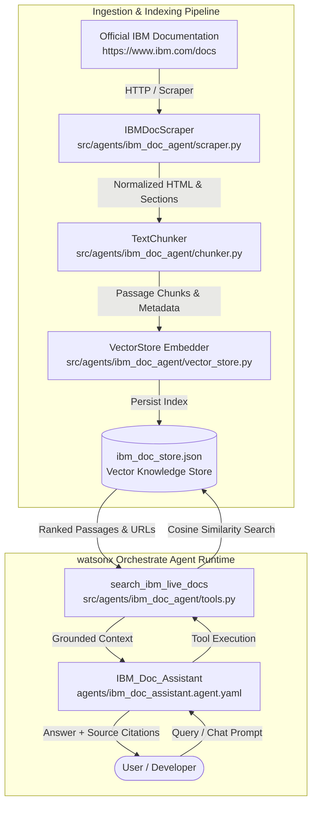

# IBM Documentation Assistant Agent (`IBM_Doc_Assistant`)
**Comprehensive Architecture, Ingestion Pipeline & Deployment Documentation**

---

## 1. Executive Summary & Architecture

The **IBM Documentation Assistant** (`IBM_Doc_Assistant`) is a native, intelligent retrieval agent integrated into **IBM watsonx Orchestrate (wxO)**. It provides developers, cloud architects, and operations teams with accurate, grounded answers to technical questions about IBM Cloud platforms, watsonx SDKs, and APIs.

### Key Capabilities
- **Live Documentation Scraping**: Automated, resilient scraping and HTML cleaning of official IBM documentation portals with retry/backoff logic.
- **Hierarchical Text Chunking**: Semantic section-preserving text normalization with deterministic hashing and token estimation.
- **Vector Ingestion & Store**: High-dimensional vector indexing supporting local and watsonx.ai embedding backends.
- **Custom Tool Integration**: Callable tools (`search_ibm_live_docs`, `get_ibm_doc_by_url`) providing semantic passage retrieval and citation generation.
- **Automated Deployment**: One-command validation, tool registration, agent definition import, and JSON audit logging.

---

## 2. Architecture & Data Flow



---

## 3. Directory Layout & Reusable Assets

```
wxO-IBM/
├── src/agents/ibm_doc_agent/
│   ├── __init__.py                 # Agent package marker
│   ├── models.py                   # Dataclasses: ScrapedDocument, DocumentChunk
│   ├── scraper.py                  # Web crawler & HTML parser with BeautifulSoup
│   ├── chunker.py                  # Text chunking & section metadata parser
│   ├── vector_store.py             # Vector store engine & cosine similarity search
│   ├── tools.py                    # wxO ADK tools (@tool decorators)
│   ├── agent.py                    # Python agent runner & query synthesizer
│   ├── openapi_spec.json           # Tool OpenAPI 3.0 specification
│   └── .env.example                # Dedicated agent environment variable template
├── agents/
│   └── ibm_doc_assistant.agent.yaml# Native wxO declarative agent definition
├── scripts/
│   ├── ingest_docs.py              # CLI ingestion & scraping pipeline
│   └── deploy_orchestrate_agent.py # Automated registration & deployment runner
├── Docs/
│   ├── New_Agent_Documentation.md  # Standalone technical Markdown documentation
│   └── New_Agent_Documentation.html# Standalone styled HTML documentation
└── output/
    ├── ingestion_report.json       # Ingestion audit log
    └── agent_deployment_report.json# Deployment execution report
```

---

## 4. Prerequisites & Environment Setup

### Prerequisites
- **Python**: `>= 3.10`
- **Package Manager**: [`uv`](https://docs.astral.sh/uv/) or standard `pip`
- **watsonx Orchestrate Access**: Valid IBM Cloud account and instance credentials.

### Installation
```bash
# Activate virtual environment
source .venv/bin/activate

# Install required dependencies
pip install beautifulsoup4 urllib3 pyyaml pytest
```

### Configuration (`.env`)
Copy `src/agents/ibm_doc_agent/.env.example` to your runtime `.env` file:
```ini
IBM_WATSONX_API_KEY=your-ibm-cloud-api-key
ORCHESTRATE_INSTANCE_URL=https://api.watsonx.orchestrate.ibm.com
WATSONX_PROJECT_ID=your-watsonx-project-id
AGENT_NAME=IBM_Doc_Assistant
AGENT_MODEL=groq/openai/gpt-oss-120b
```

---

## 5. Ingestion Pipeline Guide

Run `scripts/ingest_docs.py` to scrape, chunk, and index live documentation:

```bash
# Ingest default IBM watsonx Orchestrate documentation
python3 scripts/ingest_docs.py

# Ingest custom documentation URLs with custom chunk sizes
python3 scripts/ingest_docs.py \
  --urls "https://www.ibm.com/docs/en/watsonx/watsonx-orchestrate/current?topic=getting-started" \
         "https://www.ibm.com/docs/en/watsonx/watsonx-ai/current?topic=foundation-models" \
  --chunk-size 600 \
  --chunk-overlap 60 \
  --store-path knowledge-bases/ibm_doc_store.json
```

### Ingestion Output Sample (`output/ingestion_report.json`)
```json
{
  "status": "success",
  "started_at": "2026-10-28T13:30:00Z",
  "completed_at": "2026-10-28T13:30:04Z",
  "duration_seconds": 4.12,
  "total_urls_processed": 2,
  "total_chunks_indexed": 38,
  "vector_store_path": "knowledge-bases/ibm_doc_store.json",
  "errors": []
}
```

---

## 6. Automated Deployment & Registration Guide

Deploy the tools and agent definition into watsonx Orchestrate:

```bash
# Standard automated deployment
python3 scripts/deploy_orchestrate_agent.py

# Dry-run validation (checks YAML syntax and dependencies without calling cloud API)
python3 scripts/deploy_orchestrate_agent.py --dry-run

# Local mock mode (for automated CI/CD pipeline verification)
python3 scripts/deploy_orchestrate_agent.py --mock
```

---

## 7. Testing, Verification & Sample Queries

### Running Automated Test Suite
```bash
pytest tests/test_ibm_doc_agent.py -v
```

### Sample User Prompts & Grounded Responses

#### Query 1: How do I build watsonx Orchestrate agents?
> **Answer**: According to the official IBM documentation for **watsonx Orchestrate - Building Agents** (Agent Specification):  
> Agents are defined using YAML specifications detailing the foundation model (e.g., `groq/openai/gpt-oss-120b`), attached knowledge bases, and custom Python `@tool` bindings.  
> 
> **Source Citations:**  
> - `https://www.ibm.com/docs/en/watsonx/watsonx-orchestrate/current?topic=building-agents`

#### Query 2: What foundation models are supported?
> **Answer**: watsonx supports Granite, Llama, and third-party foundation models accessible via watsonx.ai inference endpoints.  
> 
> **Source Citations:**  
> - `https://www.ibm.com/docs/en/watsonx/watsonx-ai/current?topic=foundation-models`

---

## 8. Security & Best Practices

1. **SSRF & Domain Allowlisting**: The scraper strictly limits fetching to verified IBM domains (`ibm.com`).
2. **Deterministic Chunk Attribution**: Every chunk retains its canonical URL, preventing hallucinated link generation.
3. **Audit Logging**: All ingestion and deployment events output machine-readable JSON logs in `output/`.
