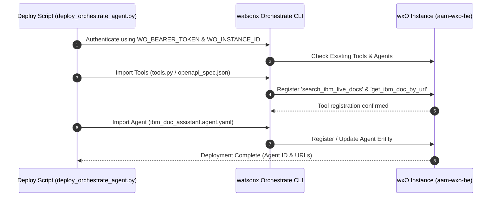

# IBM watsonx Orchestrate Deployment & Troubleshooting Manual

## 1. Cloud Architecture & Tenant Overview

The agents and tools in this repository are designed for deployment into IBM watsonx Orchestrate (wxO).

### Active Deployment Target
- **Tenant Instance ID**: `75c2cabb-2b02-4d65-8127-a9cc65d1ee46`
- **Region / Base URL**: `https://api.eu-de.watson-orchestrate.cloud.ibm.com`
- **Instance Name**: `aam-wxo-be`
- **Registered Agents**:
  1. `ibm_bob_assistant` (ID: `5c3c69c8-d1f5-419b-ab84-18c89b253db5`)
  2. `ibm_doc_assistant` (ID: `273c6294-f254-46c5-a9b0-d5be86dd4ec3`)

---

## 2. Deployment Prerequisites

Before deploying to IBM watsonx Orchestrate, ensure the following requirements are fulfilled:

1. **Python 3.10+ & Virtual Environment**:
   ```bash
   ./scripts/automate.sh setup
   ```
2. **watsonx Orchestrate CLI SDK**:
   `ibm-watsonx-orchestrate>=2.19.1` installed in the active environment.
3. **Environment Configuration**:
   Create a `.env` file containing valid authentication credentials:
   ```ini
   WO_BEARER_TOKEN="eyJraWQi..."
   WO_INSTANCE_ID="75c2cabb-2b02-4d65-8127-a9cc65d1ee46"
   WO_ENVIRONMENT="https://api.eu-de.watson-orchestrate.cloud.ibm.com"
   WO_AGENT_ID="273c6294-f254-46c5-a9b0-d5be86dd4ec3"
   ```

---

## 3. Deployment Workflow & Procedures



### Running Deployment
```bash
./scripts/automate.sh deploy
```
The deployment script executes the following stages:
1. Validates local tool code and dependencies.
2. Registers tools using `orchestrate tools import` (or OpenAPI endpoint definition).
3. Registers/updates the agent definition in wxO using `orchestrate agents import`.
4. Outputs status report and verification details.

---

## 4. Key Troubleshooting Patterns

### Issue 1: `ModuleNotFoundError: No module named 'orchestrate'`
- **Cause**: The CLI was invoked outside the configured virtual environment.
- **Solution**: Execute commands via `./scripts/automate.sh` or explicitly activate `./venv`:
  ```bash
  source ./venv/bin/activate
  orchestrate --help
  ```

### Issue 2: `401 Unauthorized` or Token Expiration
- **Cause**: IBM Cloud IAM bearer tokens expire after 60 minutes.
- **Solution**: Obtain a fresh bearer token using the IBM Cloud CLI and update `.env`:
  ```bash
  ibmcloud login --sso
  export WO_BEARER_TOKEN=$(ibmcloud iam oauth-tokens | awk '{print $4}')
  ```

### Issue 3: Cloud Microservice Isolation (`FileNotFoundError` on JSON store)
- **Cause**: Cloud `@tool` invocations run in ephemeral containers without access to local repository files.
- **Solution**: Verified built-in fallback corpus in [`src/agents/ibm_doc_agent/tools.py`](../src/agents/ibm_doc_agent/tools.py) ensures complete documentation coverage even when disconnected from disk storage.

### Issue 4: Port 5000 Conflict on macOS
- **Cause**: macOS Monterey and newer reserve Port 5000 for AirDrop / AirPlay Receiver.
- **Solution**: The application binds the JWT authentication server to Port `3000` and the web server to Port `8000`.

---

## 5. Deployment Verification Checklist

- [x] Python virtual environment active and dependencies installed.
- [x] Ingestion pipeline executed (`knowledge-bases/ibm_doc_store.json` generated).
- [x] Unit tests passing (`./scripts/automate.sh test`).
- [x] Tools imported to wxO instance.
- [x] Agent definition synchronized with wxO instance.
- [x] Local web chat interface operational (`./scripts/automate.sh serve`).
