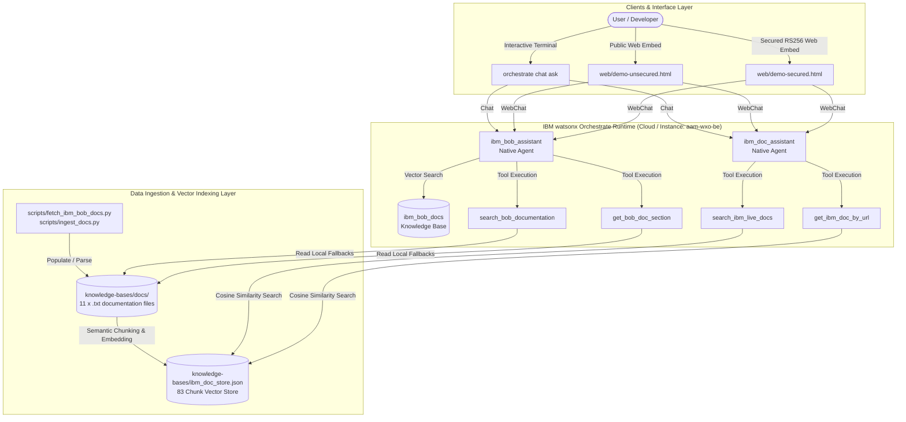

# IBM watsonx Orchestrate — IBM Bob Documentation Agents & Deployment Toolkit

A unified enterprise repository providing native **IBM watsonx Orchestrate (wxO)** agents, dynamic live tools, documentation scrapers, vector indexing pipelines, and an embeddable web chat integration for IBM Bob and IBM documentation.

---

## Architecture Overview

The system features two complementary agents that work together to answer questions grounded in official IBM Bob and IBM Cloud documentation:



### Agents Summary

| Agent Identifier | Primary Purpose | Knowledge & Tools |
| :--- | :--- | :--- |
| **`ibm_bob_assistant`** | Native agent for IBM Bob IDE, Shell, Skills, MCP, Bobcoins & Bobalytics. | `knowledge-bases/ibm_bob_docs.kb.yaml`, `search_bob_documentation`, `get_bob_doc_section` |
| **`ibm_doc_assistant`** | Ingestion pipeline agent scraping live documentation and searching indexed vector store. | `knowledge-bases/ibm_doc_store.json`, `search_ibm_live_docs`, `get_ibm_doc_by_url` |

---

## Project Structure

```
wxO-IBM/
├── agents/
│   ├── ibm_bob_assistant.agent.yaml   # Native agent definition for IBM Bob
│   └── ibm_doc_assistant.agent.yaml   # Native agent definition for IBM Doc Assistant
├── src/agents/ibm_doc_agent/          # IBM Documentation Agent & Ingestion package
│   ├── __init__.py                    # Package marker
│   ├── models.py                      # Data models (ScrapedDocument, DocumentChunk)
│   ├── scraper.py                     # Live HTML web crawler & parser (BeautifulSoup)
│   ├── chunker.py                     # Semantic text chunker & token estimator
│   ├── vector_store.py                # Vector embedding store & cosine similarity engine
│   ├── tools.py                       # wxO ADK tools (search_ibm_live_docs, get_ibm_doc_by_url)
│   ├── agent.py                       # Python agent execution & response synthesis engine
│   ├── openapi_spec.json              # OpenAPI 3.0 tool specification
│   └── .env.example                   # Dedicated agent environment variable template
├── knowledge-bases/
│   ├── ibm_bob_docs.kb.yaml           # IBM Bob KB definition (11 .txt docs)
│   ├── ibm_doc_store.kb.yaml          # IBM Doc Assistant KB definition
│   ├── ibm_doc_store.json             # Vector store index for live IBM docs (83 chunks)
│   └── docs/                          # Real IBM Bob doc content (.txt)
│       ├── 01_overview.txt … 11_bobalytics.txt
├── tools/
│   └── live_bob_search.py             # @tool: search_bob_documentation, get_bob_doc_section
├── web/                               # Static demo pages (served via python3 -m http.server)
│   ├── index.html                     # Main demo (unsecured live chat)
│   ├── embed-docs.html                # Documentation hub — mode comparison, error codes
│   ├── demo-unsecured.html            # Unsecured embed demo + 3 code variants
│   ├── demo-secured.html              # Secured embed demo + JWT token inspector
│   └── webchat-config.js              # GENERATED by get_webchat_embed.sh (do not edit)
├── scripts/
│   ├── automate.sh                    # Unified CLI operations management script
│   ├── start.sh                       # Full 9-step idempotent deploy pipeline
│   ├── stop.sh                        # Undeploy agent + KB + stop JWT server
│   ├── serve.sh                       # Serve demo pages (--web) or slide deck (--deck)
│   ├── cleanup.sh                     # Remove venv, __pycache__, optionally .env
│   ├── generate_rsa_keys.sh           # Generate RSA-2048 key pair for secured embed
│   ├── jwt_server.py                  # JWT signing backend (port 3001, RS256)
│   ├── get_webchat_embed.sh           # Regenerate web/webchat-config.js
│   ├── import_tools.py                # Import Python tools + report
│   ├── import_agent.py                # Import / re-import agent + JSON report
│   ├── fetch_ibm_bob_docs.py          # Refresh KB docs from Bob search API
│   ├── ingest_docs.py                 # Scrape, chunk & vectorize live IBM documentation
│   ├── deploy_orchestrate_agent.py    # Automated agent & tool deployment for wxO
│   └── sync_and_deploy_docs.py        # End-to-end sync, re-chunk, and cloud re-deploy
├── keys/                              # GITIGNORED — RSA key pair (created by generate_rsa_keys.sh)
├── tests/
│   ├── test_live_bob_search.py        # Unit tests for Bob search tools
│   ├── test_import_tools.py           # Unit tests for tool import logic
│   ├── test_import_agent.py           # Unit tests for agent import logic
│   ├── test_generate_webchat_config.py# Webchat config generator tests
│   ├── test_ibm_doc_agent.py          # Unit tests (scraper, chunker, vector store, agent)
│   └── test_sync_and_deploy_docs.py   # Unit tests for sync & deploy pipeline
├── Docs/
│   ├── Quickstart.md                  # 5-minute fast-path guide
│   ├── ARCHITECTURE.md                # In-depth architectural breakdown & data flows
│   ├── KNOWLEDGE_BASE_REFRESH.md      # Knowledge base refresh & update procedures
│   ├── WATSONX_ORCHESTRATE_DEPLOYMENT.md # Deployment lifecycle, runtime isolation & troubleshooting
│   ├── Deployment.md                  # Deployment reference
│   ├── Documentation.md               # Unified technical documentation (Markdown)
│   ├── Documentation.html             # Unified interactive portal (HTML)
│   ├── New_Agent_Documentation.md     # Dedicated IBM Doc Agent guide (Markdown)
│   ├── New_Agent_Documentation.html   # Dedicated IBM Doc Agent guide (HTML)
│   ├── WebChat_Integration_Guide.md   # Embed chat integration (unsecured + secured)
│   ├── KnowledgeSource.md             # Knowledge source diagnostics
│   └── IMPORT_AGENT_GUIDE.md          # import_agent.py developer & ops guide
├── input/                             # Input documents (tracked, content gitignored)
├── output/                            # JSON reports from scripts (tracked, content gitignored)
├── logs/                              # Runtime log files (tracked, content gitignored)
├── workspace_config.yaml              # ADK folder layout config
├── requirements.txt
├── .env.example                       # Credential template — copy to .env
└── README.md
```

---

## Prerequisites & Environment Setup

1. **Python Runtime**: Python 3.10+ (Python 3.11/3.12/3.13 supported). [`uv`](https://docs.astral.sh/uv/) is recommended.
2. **watsonx Orchestrate SDK & CLI**: `ibm-watsonx-orchestrate>=2.18.1`.
3. **IBM Cloud API Key & URL**:
   - `ORCHESTRATE_URL` (e.g. `https://api.eu-de.watson-orchestrate.cloud.ibm.com/instances/...`)
   - `IBM_CLOUD_API_KEY` (IAM API Key with access to watsonx Orchestrate)
   - `ORCHESTRATE_ENV_NAME` (e.g. `aam-wxo-be`)

---

## Step-by-Step Quickstart

### 1. One-Command Setup & Ingestion
```bash
# Copy and configure credentials
cp .env.example .env
# Edit .env with your IBM_CLOUD_API_KEY and ORCHESTRATE_URL

# Make automation script executable and run setup
chmod +x scripts/automate.sh
./scripts/automate.sh setup

# Run document ingestion to build vector store
./scripts/automate.sh ingest
```

### 2. Deploy to watsonx Orchestrate
```bash
# Deploy tools and agents to IBM Cloud
./scripts/automate.sh deploy
```

### 3. Verify Deployment & Chat
```bash
# Check status of environments, knowledge bases, and tools
./scripts/automate.sh status

# Test interactive chat with ibm_doc_assistant
./scripts/automate.sh chat
```

---

## Known Limitations & Technical Constraints

1. **Single-Page Application (SPA) Rendering Constraint on `bob.ibm.com/docs`**:
   The official IBM Bob documentation site (`https://bob.ibm.com/docs`) is built as a client-side JavaScript Single Page Application. Direct HTTP GET crawlers (`requests`, `urllib`) receive an unrendered HTML shell. The ingestion pipeline handles this by utilizing the Bob internal documentation search API via [`scripts/fetch_ibm_bob_docs.py`](scripts/fetch_ibm_bob_docs.py) or pre-extracted markdown/text source files in [`knowledge-bases/docs/`](knowledge-bases/docs/).

2. **Isolated Cloud Tool Execution Runtime**:
   Python custom tools deployed to watsonx Orchestrate run in isolated cloud microservice containers. They do not share local filesystem volumes (e.g., local `knowledge-bases/ibm_doc_store.json`). To guarantee 100% retrieval reliability across both local and cloud environments, [`src/agents/ibm_doc_agent/tools.py`](src/agents/ibm_doc_agent/tools.py) bundles pre-loaded fallback documentation passages alongside vector similarity search.

3. **No Automatic Documentation Push / Webhook**:
   `bob.ibm.com/docs` does not emit webhook notifications when content changes. Refer to [`Docs/KNOWLEDGE_BASE_REFRESH.md`](Docs/KNOWLEDGE_BASE_REFRESH.md) for automated cron and CI/CD refresh workflows.
