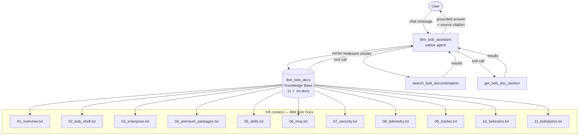

# IBM Bob Documentation Assistant — watsonx Orchestrate Agent

A native **watsonx Orchestrate** agent that answers questions about IBM Bob
features and capabilities by grounding responses in the official IBM Bob
documentation via RAG (Retrieval-Augmented Generation).

---

## Architecture



---

## Project Structure

```
wxO-IBM/
├── agents/
│   ├── ibm_bob_assistant.agent.yaml   # IBM Bob agent definition (native, react_core)
│   └── ibm_doc_assistant.agent.yaml   # IBM Doc Assistant agent definition
├── src/agents/ibm_doc_agent/          # IBM Documentation Agent & Ingestion package
│   ├── __init__.py                    # Package marker
│   ├── models.py                      # Data models (ScrapedDocument, DocumentChunk)
│   ├── scraper.py                     # Live HTML web crawler & parser (BeautifulSoup)
│   ├── chunker.py                     # Semantic text chunker & token estimator
│   ├── vector_store.py                # Vector embedding store & cosine similarity engine
│   ├── tools.py                       # wxO ADK tools (search_ibm_live_docs, get_ibm_doc_by_url)
│   ├── agent.py                       # Python agent execution & response synthesis engine
│   ├── openapi_spec.json              # OpenAPI 3.0 tool specification
│   └── .env.example                   # Dedicated agent environment variable template
├── knowledge-bases/
│   ├── ibm_bob_docs.kb.yaml           # IBM Bob KB definition (11 .txt docs)
│   ├── ibm_doc_store.kb.yaml          # IBM Doc Assistant KB definition
│   ├── ibm_doc_store.json             # Vector store index for live IBM docs
│   └── docs/                          # Real IBM Bob doc content (.txt)
│       ├── 01_overview.txt … 11_bobalytics.txt
├── tools/
│   └── live_bob_search.py             # @tool: search_bob_documentation, get_bob_doc_section
├── web/                               # Static demo pages (served via python3 -m http.server)
│   ├── index.html                     # Main demo (unsecured live chat)
│   ├── embed-docs.html                # Documentation hub — mode comparison, error codes
│   ├── demo-unsecured.html            # Unsecured embed demo + 3 code variants
│   ├── demo-secured.html              # Secured embed demo + JWT token inspector
│   └── webchat-config.js              # GENERATED by get_webchat_embed.sh (do not edit)
├── scripts/
│   ├── start.sh                       # Full 9-step idempotent deploy pipeline
│   ├── stop.sh                        # Undeploy agent + KB + stop JWT server
│   ├── serve.sh                       # Serve demo pages (--web) or slide deck (--deck)
│   ├── cleanup.sh                     # Remove venv, __pycache__, optionally .env
│   ├── generate_rsa_keys.sh           # Generate RSA-2048 key pair for secured embed
│   ├── jwt_server.py                  # JWT signing backend (port 3001, RS256)
│   ├── get_webchat_embed.sh           # Regenerate web/webchat-config.js
│   ├── import_tools.py                # Import Python tools + report
│   ├── import_agent.py                # Import / re-import agent + JSON report
│   ├── fetch_ibm_bob_docs.py          # Refresh KB docs from Bob search API
│   ├── ingest_docs.py                 # Scrape, chunk & vectorize live IBM documentation
│   └── deploy_orchestrate_agent.py    # Automated agent & tool deployment for wxO
├── keys/                              # GITIGNORED — RSA key pair (created by generate_rsa_keys.sh)
├── tests/
│   ├── test_live_bob_search.py        # 31 unit tests
│   ├── test_import_tools.py           # 56 unit tests
│   ├── test_import_agent.py           # 54 unit tests
│   ├── test_generate_webchat_config.py# Webchat config generator tests
│   └── test_ibm_doc_agent.py          # 6 unit tests (scraper, chunker, vector store, agent)
├── Docs/
│   ├── Quickstart.md                  # 5-minute fast-path
│   ├── Deployment.md                  # Full deployment reference
│   ├── Documentation.md               # Unified technical documentation (Markdown)
│   ├── Documentation.html             # Unified interactive portal (HTML)
│   ├── New_Agent_Documentation.md     # Dedicated IBM Doc Agent guide (Markdown)
│   ├── New_Agent_Documentation.html   # Dedicated IBM Doc Agent guide (HTML)
│   ├── WebChat_Integration_Guide.md   # Embed chat integration (unsecured + secured)
│   ├── KnowledgeSource.md             # Knowledge source diagnostics
│   └── IMPORT_AGENT_GUIDE.md          # import_agent.py developer & ops guide
├── input/                             # Input documents (tracked, content gitignored)
├── output/                            # JSON reports from scripts (tracked, content gitignored)
├── logs/                              # Runtime log files (tracked, content gitignored)
├── workspace_config.yaml              # ADK folder layout config
├── requirements.txt
├── .env.example                       # Credential template — copy to .env
└── README.md
```

---

## Prerequisites

- Python 3.10+, [`uv`](https://docs.astral.sh/uv/) installed
- `orchestrate` CLI installed (`ibm-watsonx-orchestrate` SDK)
- An active watsonx Orchestrate environment registered

---

## Setup

```bash
# 1. Create and activate virtual environment
uv venv venv
source venv/bin/activate
uv pip install -r requirements.txt

# 2. Copy and fill in credentials
cp .env.example .env
# Edit .env with your ORCHESTRATE_* values
```

---

## Deploy

### Option A — Full pipeline (recommended for first-time setup)

```bash
# Deploys KB + tools + agent in one idempotent step
bash scripts/start.sh
```

### Option B — Manual step-by-step

```bash
# 3. Register and activate your wxO environment
orchestrate env add --name my-wxo \
  --url $ORCHESTRATE_URL \
  --auth-token $ORCHESTRATE_TOKEN
orchestrate env activate my-wxo

# 4. Import knowledge base (11 IBM Bob doc files → Milvus index)
orchestrate knowledge-bases import -f knowledge-bases/ibm_bob_docs.kb.yaml

# 5. Check KB status — wait until Ready = True
orchestrate knowledge-bases status -n ibm_bob_docs

# 6. Import Python tools
python scripts/import_tools.py

# 7. Import agent
python scripts/import_agent.py
```

---

## Scripts

| Script | Purpose |
|---|---|
| `scripts/start.sh` | Full deploy: KB → tools → agent → Live. 9-step, idempotent. |
| `scripts/stop.sh` | Undeploy agent, KB, stop JWT server, deactivate session. |
| `scripts/serve.sh` | Serve local HTTP servers — `--web` (port 8080) or `--deck` (port 8085). |
| `scripts/cleanup.sh` | Remove `venv/`, `__pycache__/`, optionally `.env`. |
| `scripts/generate_rsa_keys.sh` | Generate RSA-2048 key pair for secured embed chat. |
| `scripts/jwt_server.py` | JWT signing backend on `:3001`; RS256, CORS, `.env` auto-load. |
| `scripts/get_webchat_embed.sh` | Regenerate `web/webchat-config.js` with live embed IDs. |
| `scripts/import_tools.py` | Import the two `@tool` functions; writes a JSON report to `output/`. |
| `scripts/import_agent.py` | Import / re-import the agent YAML; writes a JSON report to `output/`. |
| `scripts/fetch_ibm_bob_docs.py` | Refresh KB `.txt` docs from the Bob search API. |

### `import_agent.py` quick reference

```bash
# Standard import (prompts if agent already exists)
python scripts/import_agent.py

# Force re-import — skip the confirmation prompt
python scripts/import_agent.py --force

# Dry-run — validate YAML and credentials only
python scripts/import_agent.py --dry-run

# Point at a custom YAML
python scripts/import_agent.py --agent-file path/to/agent.yaml

# Verbose + suppress log file (useful in CI)
python scripts/import_agent.py --verbose --no-log-file
```

**Exit codes:** `0` = success / declined / dry-run, `1` = import failed, `2` = YAML invalid.

See [`Docs/IMPORT_AGENT_GUIDE.md`](Docs/IMPORT_AGENT_GUIDE.md) for the full
reference including CLI flags, JSON report schema, troubleshooting table, and
CI/CD integration examples.

---

## Embed Web Chat

The agent can be embedded in any web page using the IBM wxO chat widget.
Three demo pages and a documentation hub are included in `web/`:

| URL (local) | Purpose |
|---|---|
| `http://localhost:8080` | Main demo — unsecured live chat |
| `http://localhost:8080/embed-docs.html` | Documentation hub — mode comparison, auth flows, error codes |
| `http://localhost:8080/demo-unsecured.html` | Unsecured embed demo — 3 code variants, 5-step setup guide |
| `http://localhost:8080/demo-secured.html` | Secured embed demo — JWT token inspector, server health check |
| `http://localhost:3001/` | JWT signing server health check (when running) |
| `http://localhost:3001/api/token` | JWT signing endpoint |

### Serve the demo pages

```bash
./scripts/serve.sh --web       # http://localhost:8080  — main demo + chat widget
./scripts/serve.sh --deck      # http://localhost:8085  — HTML slide deck
./scripts/serve.sh --help      # usage / flag reference
```

### Unsecured embed (quickest path)

```bash
# 1. Disable embed security in the wxO UI:
#    Administration → Settings → Embed Security → Security: OFF

# 2. Serve the demo pages
./scripts/serve.sh --web

# 3. Open http://localhost:8080
```

### Secured embed (production-ready)

```bash
# 1. Generate an RSA-2048 key pair
bash scripts/generate_rsa_keys.sh

# 2. Upload keys/wxo_embed_public.pem to:
#    Administration → Settings → Embed Security → Security: ON → paste key → Save

# 3. Start the JWT signing backend
source venv/bin/activate
python scripts/jwt_server.py           # listens on :3001

# 4. Serve the demo pages
./scripts/serve.sh --web

# 5. Open http://localhost:8080/demo-secured.html

# Or launch JWT server + deploy in one command:
bash scripts/start.sh --start-jwt-server
```

> **Root cause of "Authentication Error / Agent fetching failed":**
> IBM wxO embed security is **ON by default**. Without either an uploaded RSA public key
> (secured mode) or security explicitly toggled OFF (unsecured mode), every widget auth
> request returns HTTP 401 `WXO-PROXY-10080E` ("kid not found"). See
> [`Docs/WebChat_Integration_Guide.md`](Docs/WebChat_Integration_Guide.md) for full details.

---

## Test

```bash
source venv/bin/activate
python -m pytest tests/ -v
# Expected: 141 passed
```

---

## Chat (interactive terminal)

```bash
# orchestrate chat requires a real TTY — open a terminal, not a pipe
orchestrate chat ask --agent-name ibm_bob_assistant
```

### Example queries

| User query | Expected agent behaviour |
|---|---|
| `What is IBM Bob?` | Explains Bob as an AI SDLC partner; cites overview doc |
| `What can Bob Shell do?` | Lists terminal capabilities from `02_bob_shell.txt` |
| `How do Bobcoins work?` | Explains budget tiers, monthly reset; cites `10_bobcoins.txt` |
| `What are Enterprise plan features?` | Describes admin dashboard, shared pool, Bobalytics |
| `How do I create a custom skill?` | Gives SKILL.md format + folder structure |
| `What is MCP in Bob?` | Explains Model Context Protocol, tools, security guidelines |
| `How do I disable telemetry?` | Step-by-step from settings; notes Enterprise caveat |
| `What modes does Bob have?` | Lists Code, Plan, Ask, Advanced, Orchestrator + custom |
| `What is the weather in Paris?` | Out-of-scope response — not in IBM Bob docs |

---

## Refresh KB content

The `.txt` files in `knowledge-bases/docs/` were generated by querying the
Bob internal search API.  To refresh them when the documentation is updated:

```bash
export BOB_SEARCH_API_URL=<internal-bob-search-endpoint>
export BOB_SEARCH_API_TOKEN=<your-token>
python scripts/fetch_ibm_bob_docs.py

# Re-import the KB after refreshing
orchestrate knowledge-bases import -f knowledge-bases/ibm_bob_docs.kb.yaml
```

---

## Undeploy

```bash
bash scripts/stop.sh
```

---

## Licence

Apache License 2.0 — see [LICENSE](LICENSE) for details.
